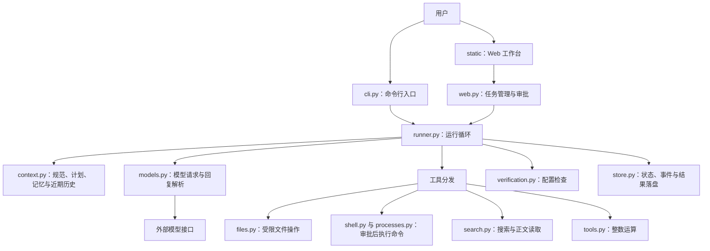
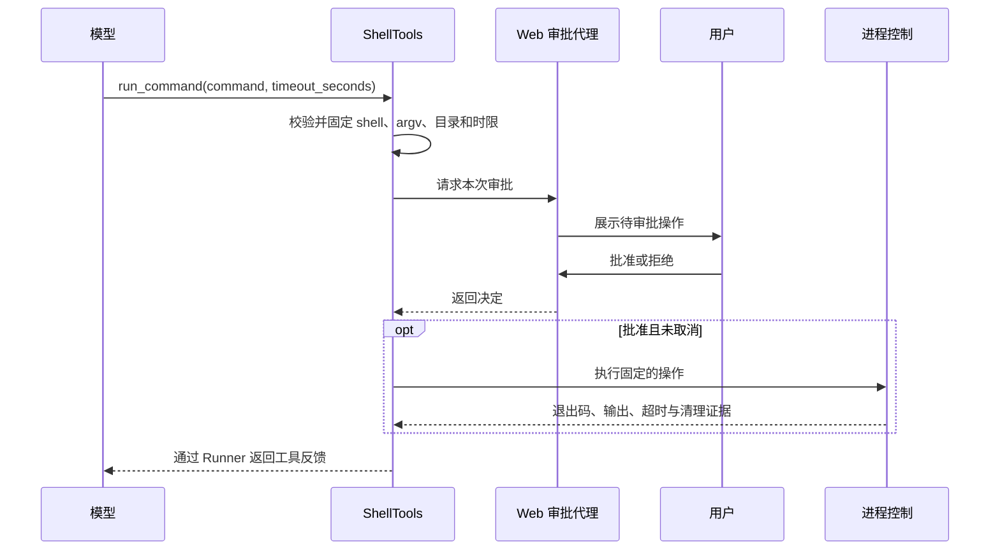

# 第一代 Harness 学习与源码对照指南

本文按当前仓库实现编写，供你一边阅读、一边打开源码和运行记录核对。第一代在这里指阶段一至七：运行核心、任务上下文与文件工具、Web 工作台、Shell 审批、恢复与检查、完整验收，以及联网搜索和正文读取。

编写日期：2026-10-16。对应编写时的代码基线：`0525a98`（联网搜索与网页正文读取）。后续代码变化时，以实现和新增验收记录为准。

建议先读第 1～4 节建立整体认识，再按第 5～10 节看代码，最后完成第 11 节练习和第 13 节自测。启动细节可随时对照 [README](../README.md) 和 [交付与复现指南](MVP_DELIVERY.md)。

## 1. 先理解这个项目解决什么问题

普通模型接口接收消息、返回回复。本项目在模型外增加一层运行程序，负责保存任务状态、向模型提供工具、执行允许的操作、反馈真实结果，并决定何时停止。

这个运行程序就是这里的 Harness。一次文件任务可以概括为：

> 用户提出目标 → 加载规范 → 模型规划 → 调用文件或命令工具 → 返回执行结果 → 模型继续决策 → 提出最终答复 → 执行配置检查 → 保存终态。

其中有三种不同的判断，阅读时应始终分开：

| 判断主体 | 负责什么 | 项目中的例子 |
| --- | --- | --- |
| 模型 | 理解任务、选择工具、记录发现、组织回答 | 决定读取 `input.txt`，再生成摘要 |
| 执行器 | 校验调用、执行操作、控制预算、保存证据 | 拒绝越界路径、等待审批、运行检查 |
| 用户 | 提出目标、配置检查、批准或拒绝命令 | 核对 `python verify.py` 后批准 |

模型生成 `run_command` 请求并不会立即启动进程；把计划标记为 `completed` 也不会直接让任务成为 `completed`。这两个区别是理解整个项目的起点。

**本节对照目标：** 能用自己的话解释：模型负责提出动作，执行器负责决定动作是否可以执行，以及结果能被证明到什么程度。

## 2. 第一代的功能地图

| 阶段 | 已实现的核心能力 | 优先阅读 | 可以核对的证据 |
| --- | --- | --- | --- |
| 一 | 真实模型请求、整数工具循环、预算、重试、取消、事件记录 | `runner.py`、`models.py`、`tools.py` | [阶段一验收](STAGE_ONE_ACCEPTANCE.md) |
| 二 | 根目录规范快照、计划、任务记忆、文件边界、哈希冲突检测 | `context.py`、`files.py` | [阶段二验收](STAGE_TWO_ACCEPTANCE.md) |
| 三 | 本地 Web 提交任务、查看轨迹、刷新恢复、模拟审批演练 | `web.py`、`static/app.js` | [阶段三验收](STAGE_THREE_ACCEPTANCE.md) |
| 四 | 真实 Shell 逐次审批、超时和取消时清理进程树 | `shell.py`、`processes.py` | [阶段四验收](STAGE_FOUR_ACCEPTANCE.md) |
| 五 | 有限格式修正、重复失败停止、副作用保护、配置检查 | `recovery.py`、`verification.py` | [阶段五验收](STAGE_FIVE_ACCEPTANCE.md) |
| 六 | 完整文件与审批样例、异常退出和重启验证、交付复现 | `examples/stage_six/`、相关测试 | [阶段六验收](STAGE_SIX_ACCEPTANCE.md) |
| 七 | Tavily 搜索、正文提取、长文续读、来源与引用编号检查 | `search.py` | [阶段七验收](STAGE_SEVEN_ACCEPTANCE.md) |

表中模块均位于 `harness/` 下，阶段六样例位于仓库根目录的 `examples/` 下。阶段编号表示开发顺序，运行时不会依次启动七个独立程序。

第一代使用本地单用户、单活动任务的 Python 单体架构：FastAPI 后端同时提供静态页面和 API，Uvicorn 提供 HTTP 服务，前端是原生 HTML、CSS、JavaScript。模型通过 OpenAI 兼容的 Chat Completions 工具协议访问。

当前边界也需要一起记住：只有任务内记忆；历史记录可查看但不支持断点续跑；只加载工作目录根部的 `AGENTS.md`；没有多 Agent、沙箱、账号、多模型路由或自动部署。联网默认关闭。

## 3. 一张图看懂模块之间的关系



两种入口共用 `Runner`，因此文件边界、预算和最终检查主要在同一个执行核心中实现。Web 额外提供审批代理，`Runner` 收到审批代理后才组合 Shell 能力。普通 CLI 没有这个代理。

阅读入口分别是：

- CLI：[`__main__.py`](../harness/__main__.py) → [`cli.main`](../harness/cli.py) → `execute` → `Runner.run`。
- Web：`cli.main` 的 `serve` 分支 → [`web.serve`](../harness/web.py) → `RunManager.start` → `run_model` → `Runner.run`。
- 浏览器：[`app.js`](../harness/static/app.js) 中的 `boot`、`submit`、`poll`、`action`。

## 4. 一次任务到底怎样运行

打开 [`Runner.run`](../harness/runner.py)，按以下顺序阅读。方法内部的 `check`、`controlled`、`dispatch`、`finish` 是理解控制逻辑的关键。

| 步骤 | 实际发生的事情 | 重点核对 |
| --- | --- | --- |
| 1. 初始化 | 检查任务和工作目录，创建运行记录，设置计数器与截止时间 | `metadata.json` 保存任务和配置快照 |
| 2. 加载上下文 | 读取根目录规范，建立计划和任务记忆对象 | `rules.json`、`state.json` |
| 3. 组合能力 | 按配置组合整数、文件、状态、联网和可选 Shell 工具 | 工具可用性由程序决定 |
| 4. 拼装请求 | 固定上下文加近期完整交互组，再加入预算、联网及检查提示 | 不会每轮发送全部历史 |
| 5. 请求模型 | 校验输入长度，受单次时限和总时限控制，必要时有限重试 | 一轮可能包含多次请求尝试 |
| 6. 校验回复 | 检查结构、结束原因、输出大小、工具数量和调用 ID | 结构非法的批次不执行工具 |
| 7. 执行工具 | 按回复中的顺序逐个分发，保存请求与反馈 | 同一批工具当前是顺序执行 |
| 8. 反馈后再决策 | 将工具结果作为 `role=tool` 消息加入当前交互组 | 下一次请求应能看到反馈 |
| 9. 处理最终答复 | 无工具调用且有非空回答时，决定是否运行配置检查 | 没有检查时为 `unverified` |
| 10. 收尾 | 保存状态、答案、操作、产物、检查、用量及停止原因 | `run_finished` 与 `result.json` |

可用下面的简化伪代码帮助定位，具体分支以源码为准：

```text
加载任务、规范、预算和工具
对预算内的每一轮：
    检查取消与总时限
    组装上下文并请求模型
    校验模型回复
    如果请求工具：
        顺序执行并记录反馈，进入下一轮
    否则：
        没有配置检查 → unverified
        检查全部通过 → completed
        检查失败且仍可修正 → 反馈证据，进入下一轮
        检查失败且不能再修正 → verification_failed
预算耗尽或发生错误 → 保存对应终态
```

**特别注意最后一轮：** 默认 `max_turns=8`，第 8 轮留给最终答复，传给模型的工具列表为空。即使模型仍返回工具请求，执行器也会阻止派发。这意味着最多有 7 轮可以提出工具调用，并不是只能调用 7 个工具。执行器发起的最终配置检查仍可运行，Shell 检查仍需审批。

## 5. 看懂模型和工具之间的协议

先读 [`contracts.py`](../harness/contracts.py)，再读 [`models.py`](../harness/models.py) 和 [`tools.py`](../harness/tools.py)。

| 类型或方法 | 含义 |
| --- | --- |
| `ToolCall` | 一次调用的 ID、工具名，以及 JSON 字符串形式的参数 |
| `ModelReply` | 模型文本、工具请求、用量和结束原因 |
| `ToolResult` | 执行器返回的 `ok`、`data`、`error`、`truncated` |
| `ModelError` | 程序定义的错误代码及是否允许重试 |
| `schemas()` | 向模型描述可调用工具及参数格式 |
| `execute()` | 在程序中真正校验参数并执行操作 |

一次整数工具调用的示意结构如下。ID 仅为演示，不是固定值：

```json
{
  "id": "call_example_add",
  "type": "function",
  "function": {
    "name": "add_integers",
    "arguments": "{\"a\":47,\"b\":58}"
  }
}
```

执行反馈的内容则是：

```json
{"ok": true, "data": {"value": 105}, "error": null, "truncated": false}
```

`Runner` 用 `tool_call_id` 将反馈关联到原始调用，再把反馈的 JSON 放进 `role=tool` 消息。模型下一轮消费该结果，才形成“调用 → 观察 → 再决策”的闭环。

模型看到的参数 Schema 只是声明；`execute()` 中的运行时检查才实际约束输入。例如整数工具要求参数恰好是 `a`、`b`，值必须是真正的整数，不能用布尔值替代。

模型适配器当前以 `stream=false` 请求完整回复，并限制响应字节数。源码使用 `client.stream` 分块接收 HTTP 数据，是为了控制接收大小；这并不表示页面已有逐 token 流式输出。

**对照问题：** 在 `cli.check_live_evidence` 中找出为什么只看到最终答案“315”不够，还要检查“105 的反馈进入后续请求”和“315 的反馈被模型消费”。

## 6. 规范、计划、记忆和历史有什么区别

核心代码在 [`context.py`](../harness/context.py)。

| 内容 | 从哪里来 | 如何保留 | 能证明什么 |
| --- | --- | --- | --- |
| 项目规范 | 工作目录根部 `AGENTS.md` | 本次启动时冻结，记录原始字节 SHA256 | 本次采用了哪版规则 |
| 计划 | 模型调用 `update_plan` | `state.json` 保存最新值，事件保留变更原因 | 模型记录的步骤与进度 |
| 任务记忆 | 模型调用 `update_memory` | 最新值持续进入模型上下文 | 模型记录的发现及来源 |
| 近期历史 | 模型回复和工具反馈 | 默认保留最近 4 个完整交互组 | 最近具体发生了什么 |
| 全部事件 | 执行器持续记录 | `events.jsonl` | 复盘运行过程的执行记录 |

`TaskContext.assemble` 固定加入执行规则、规范快照、原任务、当前计划和记忆，再附加近期历史。`Runner` 还会加入本轮预算、网络来源索引和配置检查等信息。

历史裁剪以完整交互组为单位，避免留下工具反馈却丢掉对应调用。当前没有自动历史摘要；较早的发现要由模型及时记录到任务记忆中。落盘的全部日志也不会自动重新灌入模型。

计划步骤包含 `id`、`goal`、`status`、`completion_condition`；修改计划还要提供 `reason`。状态支持 `pending`、`in_progress`、`completed`、`blocked`。

记忆包含 `goal`、`constraints`、`progress`、`findings`、`artifacts`、`unresolved`。每条发现需要 `text`、`source`、`kind`，其中 `kind` 区分 `fact` 和 `hypothesis`。即便标为 `fact`，它仍是模型记录，不能替代执行器检查。

两个更新工具均提交完整替换值，使用时要保留仍然需要的旧内容。普通文件工具在没有计划时会返回 `plan_required`；这个硬约束在 `RunTools.execute` 中，不能据此推断所有工具都要求先规划。

**本节对照目标：** 能解释为什么刷新页面后还能看到日志，而任务中较早的工具反馈仍可能不在模型下一轮的输入中。

## 7. 文件操作和 Shell 的边界

### 7.1 文件工具：先读哈希，再按版本写入

阅读 [`FileTools.path/read/write`](../harness/files.py)。

文件工具使用工作目录内的相对路径，拒绝绝对路径、`..`、盘符及部分 Windows 特殊路径；解析后的目标仍必须位于工作目录内。写入还会拒绝链接等别名路径，并禁止修改名为 `AGENTS.md` 的规则文件。

修改已有文件时：

1. `read_file` 返回内容和原始字节 `sha256`。
2. 模型构造新内容。
3. `write_file` 携带该哈希作为 `expected_hash`。
4. 写入前重新核对；内容已变化则返回 `file_conflict`。

新文件使用 `expected_hash=null`，底层用独占创建防止覆盖已经出现的文件。文件工具不会自动创建缺失的父目录。

默认单个文件最多 65,536 字节，规范最多 16,384 字节；目录列表最多 200 项且不递归。文件需为受支持的 UTF-8 文本，超大文件整读会被拒绝。已有文件更新保留 UTF-8 BOM 和 LF/CRLF 风格，混合换行会拒绝；新文件使用 UTF-8 无 BOM、LF。

这些措施面向可信本地目录，不能提供对恶意外部修改的完整事务保证。

### 7.2 Shell：每次执行均取得独立批准

阅读 [`ShellTools.execute`](../harness/shell.py)、[`RunManager.request_approval/decide`](../harness/web.py) 和 [`run_process`](../harness/processes.py)。



审批绑定本次运行和审批 ID，并校验待决定状态、取消状态及截止时间。前端禁用按钮只是交互辅助，真正防止重复审批的是后端。

Windows 使用系统 Windows PowerShell 非交互执行；进程控制使用 Job Object 管理正常子孙进程。命令结束会清理残余后台子进程；取消或超时也会清理。无法确认进程结束时，任务失败，当前 Web 服务阻止新任务。

Shell 可以访问工作目录以外资源，文件工具的路径限制不约束 Shell。当前设计也不支持通过命令启动长期后台服务。普通 CLI 不提供 Shell，配置 Shell 检查也不会自动获得执行权限。

## 8. 恢复、检查与最终状态

### 8.1 四类“再试一次”需要分清

| 场景 | 当前行为 | 源码入口 |
| --- | --- | --- |
| 临时模型请求失败 | 对适合重试的错误有限指数退避，仍计入模型请求预算和总时限 | `models.py`、`Runner.run` |
| 模型回复结构错误 | 在有限修正次数内反馈错误，要求重新输出；该非法批次不执行工具 | `parse_reply`、`REPAIRABLE_MODEL_ERRORS` |
| 工具执行失败 | 反馈失败，由模型决定如何修正；相同操作连续失败达到阈值停止 | `dispatch`、`Recovery.observe` |
| 最终检查失败 | 将检查证据反馈模型，在剩余预算内修正，再次提出最终答复 | `verify`、`Runner.run` |

阅读 [`Recovery.blocked/observe`](../harness/recovery.py) 时，重点看三个保护：写入结果不确定时，重写前要成功读取该文件；普通重调的不确定 Shell 命令会被阻止；明确拒绝的相同命令本次运行不再审批。配置的可重复检查允许重新执行，但仍要新审批。

默认连续失败阈值为 3，按工具名和参数识别相同操作；成功更新计划或记忆不会清零该计数。恢复不会重新获得一套轮数或总时间。

### 8.2 最终检查由配置决定

阅读 [`verification.py`](../harness/verification.py)。当前支持：

- `file_contains`：在受限文本文件中检查指定子串。
- `shell`：通过工具分发执行检查命令，以工具是否成功判定，仍逐次审批。

下面是一个可合并进启动 JSON 的字段片段：

```json
{
  "checks": [
    {"id": "source", "type": "file_contains", "path": "summary.txt", "text": "来源：input.txt"}
  ]
}
```

模型给出最终答复后，执行器才运行这些检查。默认最多检查 2 次，包含初次；失败且仍有轮数、时间等预算时可反馈修正。最后一轮检查失败直接形成检查失败终态。

`file_contains` 只能证明某个子串存在；要验证精确格式、数值或行为，应配置相应检查。Shell 返回的是实际 PowerShell 进程退出码；原生命令需要显式传播退出码时，应将 `; exit $LASTEXITCODE` 一并写入待审批命令。

### 8.3 学会读状态，而不只读回答

| 状态 | 应怎样理解 |
| --- | --- |
| `running` / `awaiting_approval` / `verifying` / `cancelling` | Web 中的运行阶段，还不是最终结果 |
| `completed` | 配置的检查全部通过；`verified=true` |
| `unverified` | 模型产生最终回答，但没有配置检查 |
| `verification_failed` | 配置检查未通过，无法继续修正 |
| `failed` | 请求、工具恢复或执行器发生失败，结合 `reason` 阅读 |
| `cancelled` | 已响应取消；已发生的文件修改等副作用不会撤销 |
| `budget_exceeded` | 轮数、调用、时间或输入等预算达到限制 |
| `interrupted` | 旧记录没有终态，供查看，不自动续跑 |

CLI 普通任务对 `completed` 和 `unverified` 都返回退出码 0，用户取消为 130，配置或文件加载错误为 2，其他任务失败为 1。因此退出码 0 也不能单独证明业务结果已验证。

## 9. 联网：搜索、正文、来源和续读

阅读 [`NetworkTools`](../harness/search.py)，依次看 `available`、`schemas`、`_request`、`_search`、`_read`、`citation_check`。

联网需同时满足启动 JSON 的 `network_enabled=true` 和环境中的 `TAVILY_API_KEY`。满足后模型可在预算内自动使用联网工具，无逐次网络审批；查询词和待读网址会发送给 Tavily。

| 对象 | 用途 | 核对要点 |
| --- | --- | --- |
| `web_search` | 发现网页，返回标题、网址、摘要和来源编号 | 有摘要不表示读过正文 |
| `read_webpage(url=...)` | 首次提取并读取指定网页正文 | 用户给网址时可直接读取 |
| `read_webpage(document_id=..., offset=...)` | 继续读取本次任务保存的正文 | 使用返回的 `next_offset`，不逐段重新抓取 |
| `S1` 等来源编号 | 将回答引用关联到来源条目 | 来源保存在 `sources.json` |
| `D1` 等文档编号 | 标识保存的提取正文 | 正文保存在 `web-D1.json` 等文件 |
| `read_ranges` | 合并实际返回过的字符区间 | 区间覆盖保存正文才算遍历完保存内容 |
| `citation_check` | 检查最终回答引用的 `[S#]` 是否存在 | 不检查每项陈述是否得到来源支持 |

必须区分三件事：提取成功、读到最后一段、读完全部保存正文。跳到末尾会留下中间未读区间；保存正文也可能因上限被截断，甚至提取服务本身就没有取得原网页的全部内容。

URL 和 DNS 预检会拒绝本机、私网等非公开目标，但实际抓取由 Tavily 完成，本地检查不能保证第三方的全部重定向和连接路径。网页内容作为不可信资料，不能授予 Shell 权限或改变执行器规则。

## 10. 配置、持久化与 Web 展示

### 10.1 配置优先级和几个关键预算

阅读 [`load_config`](../harness/config.py) 和 [`config.example.json`](../config.example.json)。加载器优先级是：显式覆盖项 > 已有进程环境 > 显式 `.env` > JSON > 默认值。当前环境映射的普通配置字段为 `HARNESS_PROVIDER`、`HARNESS_MODEL`、`HARNESS_BASE_URL`；时限、轮数等主要从 JSON 配置，不能任意猜测环境变量名。

`HARNESS_API_KEY` 和 `TAVILY_API_KEY` 放在本机环境或显式 `.env` 中，不是 `Config` 字段。未知 JSON 字段会被拒绝。加载器支持显式覆盖项，但当前 CLI 并未为每个配置字段提供覆盖参数。

| 配置 | 当前默认值 | 阅读时要理解 |
| --- | --- | --- |
| `max_turns` | 8 | 最后一轮保留给最终回答 |
| `max_model_calls` | 16 | 包括重试请求，与轮数分别控制 |
| `max_tool_calls_per_turn` / `max_tool_calls` | 4 / 64 | 单回复工具数与总派发数；Shell 检查也占总调用预算 |
| `request_timeout_seconds` / `total_timeout_seconds` | 90 / 360 秒 | 单次模型请求和整项任务的时限 |
| `tool_timeout_seconds` | 5 秒 | 普通工具时限；网络和 Shell 有专门处理 |
| `approval_timeout_seconds` / `shell_timeout_seconds` | 60 / 60 秒 | 审批等待与单命令执行上限，均占总时限 |
| `recent_history_turns` | 4 | 保留完整交互组，不是最后 4 条消息 |
| `max_input_chars` / `max_output_chars` | 64,000 / 8,000 | 字符预算，不是 token 数；输入检查包括工具 Schema |
| `max_completion_tokens` | 1,024 | 模型生成 token 上限，由供应商协议解释 |
| `max_retries` | 2 | 对可重试请求最多再试两次，仍受其他预算约束 |
| `max_search_requests` / `max_extract_requests` | 5 / 10 | 实际外部请求上限，网络重试同样占次数 |
| `web_chunk_chars` | 4,000 | 单段正文输出的字符上限 |
| `checks` / `network_enabled` | `[]` / `false` | 默认没有结果检查，且不启用联网 |

改配置后重启服务，新任务才使用新值；旧任务看自己的 `metadata.json` 配置快照。增加预算只是增加允许的工作量，不能代替改善任务要求和验证标准。

### 10.2 到运行目录寻找证据

阅读 [`RunStore`](../harness/store.py)。默认数据在 `runs/<run-id>/`；ID 按服务电脑的本地日期加当日序号分配，例如 `20261016001`。不同 `runs_dir` 的编号可能相同，定位记录要同时确认父目录。事件时间戳使用 UTC。

| 文件 | 建议怎样看 |
| --- | --- |
| `metadata.json` | 核对原任务、工作目录、配置、运行模式 |
| `rules.json` | 核对实际使用的规范及 SHA256 |
| `state.json` | 看最新计划与记忆，不把它当完整历史 |
| `events.jsonl` | 按 `sequence` 追踪请求、回复、工具、审批和检查 |
| `result.json` | 看 `status`、`reason`、`answer`、`checks`、`operations`、`unresolved` |
| `sources.json`、`web-D<n>.json` | 联网启用时核对来源索引和已保存正文 |

JSON 状态通过临时文件替换保存，事件逐行追加并刷新落盘；配置的密钥值会被脱敏。运行内容仍可能包含任务材料，脱敏不代表日志适合任意公开。

### 10.3 Web 为什么刷新后能恢复

浏览器通过 API 读取运行快照和增量事件，`after` 游标代表已经读取到的事件序号。当前前端定时轮询，不依赖 WebSocket；任务保存在服务端，页面刷新不会重新提交任务。

| API | 用途 |
| --- | --- |
| `GET /api/session` | 获取当前会话 token 和默认工作目录等信息 |
| `POST /api/runs` | 提交任务，返回运行 ID |
| `GET /api/runs` | 列出历史任务 |
| `GET /api/runs/<id>` | 获取状态、结果、规范、记忆、检查和审批快照 |
| `GET /api/runs/<id>/events?after=<sequence>` | 增量读取事件 |
| `POST /api/runs/<id>/cancel` | 请求取消 |
| `POST /api/runs/<id>/approvals/<approval-id>` | 提交批准或拒绝 |

接口有 Host、Origin、会话 token 等检查；操作接口需要符合后端的同源要求。日常学习用工作台即可。服务只监听 `127.0.0.1`，使用输出的精确地址；改成 `localhost` 会因 Host 不匹配被拒绝。

页面最多保留近期 300 条日志/轨迹节点；完整事件仍在磁盘。关闭页面不取消任务，停止显示日志也不等于停止执行。服务重启后刷新获取新会话；旧的未完成任务显示中断，不恢复旧审批。

## 11. 按顺序完成五个练习

以下命令均在仓库根目录运行。练习会产生本机文件；真实模型和联网练习会消耗对应 API 用量。本文编写时未重新调用模型或启动测试服务。

### 练习一：配置环境并看一次最小闭环

首次创建环境；已有 `harness` 环境时跳过创建：

```powershell
conda env create -f environment.yml
conda activate harness
if (-not (Test-Path -LiteralPath .env)) {
    Copy-Item -LiteralPath .env.example -Destination .env
}
```

在本机填写 `.env` 的模型地址、模型标识和密钥，再运行：

```powershell
python -m harness live-check --env-file .env --config config.example.json
```

**观察点：** 找到 `live_check_passed: true`，再到对应 `events.jsonl` 核对加法结果 105、后续乘法结果 315，以及消费反馈后的最终答复。因为默认无配置检查，任务状态应为 `unverified`；专项闭环检查通过和任务 `completed` 是不同概念。

### 练习二：把命令行与 Runner 对上

```powershell
python -m harness run --env-file .env --config config.example.json --task "使用工具计算47+58，再把工具返回值乘以3，报告结果。"
```

**观察点：** 从 `cli.execute` 跟到 `Runner.run`；对照 `model_requested`、`model_responded`、`tool_requested`、`tool_responded`、`run_finished`。记录实际轮数、请求数和工具数，解释为什么它们不必相等。

### 练习三：在 Web 完成完整文件样例

复制模板到独立目录，并使用样例自己的配置：

```powershell
New-Item -ItemType Directory -Path runs -Force
$learningSampleDir = Join-Path (Get-Location).Path ("runs/learning-gen1-" + [guid]::NewGuid().ToString("N"))
Copy-Item -LiteralPath examples/stage_six -Destination $learningSampleDir -Recurse
Write-Output $learningSampleDir
Get-Content -LiteralPath (Join-Path $learningSampleDir task.txt) -Raw -Encoding UTF8
python -m harness serve --env-file .env --config (Join-Path $learningSampleDir config.json)
```

打开输出地址，将独立目录和 `task.txt` 内容填入页面。先阅读样例规范和检查脚本，再核对每次命令审批。

**观察点：**

1. 规范快照与样例 `AGENTS.md` 一致，计划有完成条件。
2. 任务记忆记录 47、58、105 及来源 `input.txt`，后续决策能使用它们。
3. `summary.txt` 精确包含以下四行，并保留最后一个 LF：

   ```text
   资料摘要
   合计：105
   乘三结果：315
   来源：input.txt
   ```

4. 正常样例先由模型请求一次 `python verify.py`，最终答复后执行器再发起同一配置检查，需要两次独立审批。执行失败或修正时以实际轨迹为准。
5. 最终 `completed` 的证据应来自 `summary_source` 和 `exact_summary` 配置检查，而不只是计划完成或模型声称成功。
6. 输入材料、规范和检查脚本没有被修改。

用 Ctrl+C 停止本次服务并等待退出。在另一个终端检查刚才使用的端口；没有输出表示当前未发现该端口监听：

```powershell
Get-NetTCPConnection -LocalPort 8765 -State Listen -ErrorAction SilentlyContinue
```

若改用了其他端口，替换为实际端口。若仍有监听，先核对 `OwningProcess` 是否属于本次启动的服务，再清理对应进程和子进程；不要批量停止其他服务。

### 练习四：观察拒绝和取消

使用自己的练习副本重新启动服务。可先点击“模拟审批演练”熟悉批准、拒绝和过期；这个模式不调用模型、不执行真实命令，不代表模型能力测试。

再新建真实样例任务，在命令审批时选择拒绝，或在运行中请求取消。

**观察点：** 拒绝的命令没有对应的 `shell_process_started` 执行事件；取消先显示“正在取消”，终态落盘后再显示已取消。模型收到拒绝后可能调整行为，因此拒绝并不必然对应某个固定任务终态。刷新只恢复记录，不再次执行。

练习结束同样停止本次服务，核对对应进程退出和端口释放。

### 练习五：联网后核对正文证据

在独立 JSON 配置副本中将 `network_enabled` 改为 `true`，在本机 `.env` 填写 `TAVILY_API_KEY`。JSON 文件按 UTF-8 无 BOM、LF 保存。下面用 `config.learning-network.json` 作为你创建的副本文件名：

```powershell
python -m harness run --env-file .env --config config.learning-network.json --task "搜索 HTTPX 官方 timeouts 文档，读取正文后解释四种超时，列出来源编号和网址。"
```

**观察点：** 是否先获得来源，再提取正文；后续模型请求是否包含正文反馈；最终引用是否能对应来源。长文练习继续检查 `document_id`、`next_offset`、`read_ranges` 和实际提取请求数。

若没有配置检查，仍应为 `unverified`。搜索和提取成功、引用编号有效，都不能单独证明答案的全部事实正确。

## 12. 用现有测试验证自己的理解

测试文件本身就是行为示例。建议带着一个具体问题阅读，而不是先逐行读完所有测试。

| 想确认的问题 | 优先阅读 |
| --- | --- |
| 重试是否重复执行已完成工具、取消能否打断等待 | [`test_runner.py`](../tests/test_runner.py)、[`test_http_integration.py`](../tests/test_http_integration.py) |
| 文件哈希冲突、编码保留、路径与链接边界 | [`test_stage_two.py`](../tests/test_stage_two.py) |
| 刷新是否只读、审批能否重复使用 | [`test_web.py`](../tests/test_web.py) |
| 未批准能否启动、超时和取消是否清理进程树 | [`test_stage_four.py`](../tests/test_stage_four.py) |
| 不确定副作用、检查失败修正、无检查时的状态 | [`test_stage_five.py`](../tests/test_stage_five.py) |
| 最后一轮是否阻止工具、是否仍受预算与取消约束 | [`test_final_response.py`](../tests/test_final_response.py) |
| HTTP 服务硬退出、重启和历史审批失效 | [`test_stage_six.py`](../tests/test_stage_six.py) |
| 长文续读、来源保存、请求预算、取消和不安全网址 | [`test_stage_seven.py`](../tests/test_stage_seven.py) |
| 页面文本安全、日志上限、审批与标签交互 | [`test_web_ui.js`](../tests/test_web_ui.js) |

基本回归命令如下，不调用外部模型；其中部分测试会启动本地 HTTP 服务或子进程，并由测试负责清理：

```powershell
conda activate harness
python -m unittest discover -s tests -v
node tests/test_web_ui.js
python -m pip check
```

如果想看真实模型端到端记录，先阅读 [阶段六验收](STAGE_SIX_ACCEPTANCE.md) 和 [阶段七验收](STAGE_SEVEN_ACCEPTANCE.md)，再决定是否执行下列会产生外部 API 用量的脚本：

```powershell
python -m tests.live_stage_six
python -m tests.live_stage_seven --env-file .env
```

它们会创建独立验收目录和测试服务，结束时清理自己启动的服务。报告中的历史通过记录属于当时的代码和配置；阅读历史报告不等于在你当前环境重新跑过。`runs/` 中原始记录属于本机文件，若已清理，报告中的绝对路径可能不再可用。

## 13. 学完后的对照清单

完成后逐项勾选，并尽量附上一个函数名、事件或结果字段作为依据。

- [ ] 能从 CLI 和 Web 两种入口定位到同一个 `Runner.run`。
- [ ] 能画出一次模型调用、工具执行、反馈再进入模型的完整循环。
- [ ] 知道 Schema 声明与后端运行时校验各自的作用。
- [ ] 能区分轮数、模型请求数、工具调用数，以及它们的独立预算。
- [ ] 能解释最后一轮为何不再允许模型工具调用。
- [ ] 能区分规范快照、计划、任务记忆、近期历史和完整事件日志。
- [ ] 知道计划和记忆更新是完整替换，且它们不等于检查证据。
- [ ] 能说明修改已有文件为什么需要 `expected_hash`。
- [ ] 知道文件工具边界不约束 Shell，审批也不等于沙箱。
- [ ] 能定位审批单次有效、拒绝不重调和取消时清理的实现。
- [ ] 能解释为什么失败的写入或命令不能直接无条件重试。
- [ ] 能从 `checks` 说明 `completed` 具体证明了什么。
- [ ] 知道 `unverified`、CLI 退出码 0 和业务正确之间的区别。
- [ ] 能从 `reason` 找出一次失败属于预算、请求、检查还是执行问题。
- [ ] 能解释刷新恢复记录与断点续跑的区别。
- [ ] 能区分搜索摘要、部分正文、全部保存正文和原网页完整内容。
- [ ] 能核对来源编号、文档编号、读取范围与最终引用。
- [ ] 能独立完成样例，并在结束后确认本次服务进程退出、端口释放。

可用以下问题做最后一次口头自测：

1. 模型说“测试通过”，但没有配置 `checks`，最终是什么状态？——`unverified`。
2. 计划全部完成，但没有有效最终回答，算交付了吗？——不算；查看最终回答和停止原因。
3. 读完文件后被其他程序修改，再拿旧哈希写入会怎样？——返回冲突，先重新读取核对。
4. 同一个命令批准过一次，最终 Shell 检查还要批准吗？——要，检查是一次新执行。
5. 最后一轮仍返回工具调用会怎样？——执行器阻止派发，以轮数预算耗尽结束。
6. 读取长文最后一段能否说明读完？——不能，要检查已读区间是否覆盖全部保存正文。
7. 浏览器关了，任务是否取消？——不会，取消需要显式请求。
8. 重启后能否沿用旧审批接着执行？——不能，只恢复查看已有记录。

需要继续深入时，按 [阶段实现计划](../HARNESS_MVP_IMPLEMENTATION_PLAN.md) 找到对应设计文档，再回到本指南列出的实现和测试核对。一个功能应能同时对应到目标、实现入口和可复查的证据。
