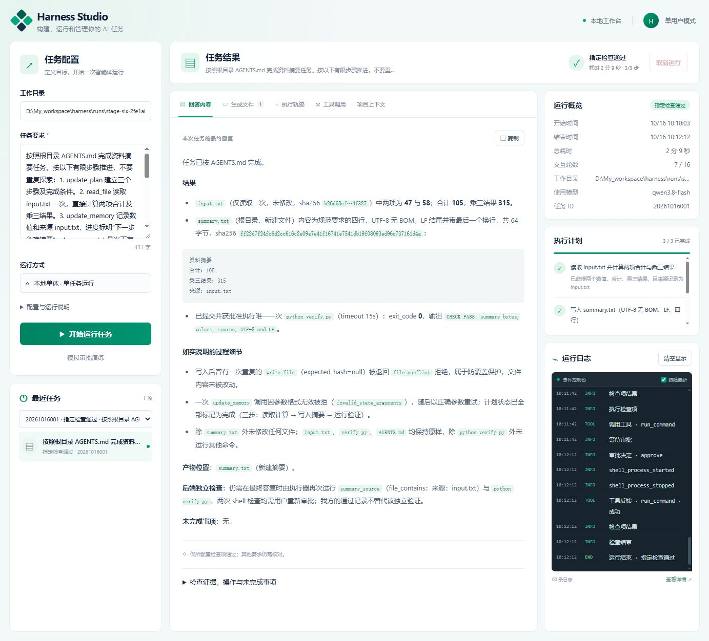

# 阶段六：端到端验收与交付

日期：2026-10-16。采用已有 Windows harness conda / Python 3.12 环境；保持 Python 后端同时提供页面与 API 的单体架构，没有扩展多 Agent、自动长期记忆或 hooks。

最终 112 项 Python 测试全部通过（75.2 秒），Node 前端回归、pip check 和 CLI 启动入口检查均通过。扫描全部 97 个受管理及未忽略的 UTF-8 文本文件，没有换行违规；本次交付文本均为 UTF-8 无 BOM、LF，git diff --check 通过。本阶段没有修改生产执行器、增加依赖或更换部署方式。

## 交付内容

- [examples/stage_six](../examples/stage_six/)：规范、输入、任务、精确字节检查脚本、含独立 shell 检查的配置。
- [MVP_DELIVERY.md](MVP_DELIVERY.md)：从源码启动、手工 Web 任务、自动复现、配置、历史查看、停止与限制。
- [stage-six-live.json](stage-six-live.json)：真实模型、完整配置、时间、路径、审批、检查及服务清理证据。
- [stage-six-tests.txt](stage-six-tests.txt)、[stage-six-checks.json](stage-six-checks.json)：全套工程检查、运行环境及依赖版本。
- [stage-six-workbench.jpg](stage-six-workbench.jpg)：实际浏览器完成后刷新恢复的最终页面。

## 真实 Web 完整任务

通过 computer-use 浏览器接口在实际本地页面填写工作目录与 task.txt，点击开始；使用真实配置的 qwen3.8-flash，不使用脚本模型或生产降级路径。成功运行在隔离 records 目录中编号为 20261016001，其具体目录见报告。

真实模型完成加载规范、规划、读取 input.txt、持久化四条带来源事实、创建 summary.txt、经页面批准运行 python verify.py、消费命令结果并完成计划与答复。执行器随后发起第二次独立审批的最终检查，同一命令再次获批、退出码为 0，两项配置检查通过，终态 completed。

14 项链路核对全部通过，包括规范字节哈希、计划与事实记忆、近期历史裁剪、精确 UTF-8/LF 产物、原始材料/规范/检查脚本不变、独立审批与实际命令/工作目录/时限一致、批准事件先于进程启动、两个进程树结束、答案使用 315、页面事件与磁盘逐序对应、刷新只读和报告对应产物。

记忆并非只落盘：事件 13 保存 input.txt 来源的事实；事件 21 的后续模型请求在固定上下文中带入它们；事件 26 的后续 shell 决策发生在该请求之后。报告记录这三个序号。该证据表明记忆实际进入后续决策上下文，不宣称可读取模型内部思维。

页面待审批时刷新恢复同一个审批 ID；第一次与最终检查的审批 ID 和调用 ID 均不同。完成后再次刷新，终态及最终答案均恢复，没有新增执行事件。实际截图见下图。

过程中模型曾重复创建已存在文件，被 file_conflict 拒绝，没有覆盖；一次 update_memory 参数无效后得到反馈并正确修正。这些事件保留，最终答复也如实说明，未把非完美过程省略成无错误轨迹。

## 失败尝试与验收器修正

首次真实运行将近期历史缩至一轮，模型反复探索未推进；越界路径请求被执行器拒绝。该次经页面取消，没有执行 shell 或写产物，记录保存在 [stage-six-first-attempt.json](stage-six-first-attempt.json)。随后仅调整样例为默认四轮近期交互，并明确新文件 expected_hash=null，重新运行成功；没有修改生产预算或绕过边界。

初版验收器将“记忆参与后续决策”错误收窄为“首次写入前必须存在另一轮模型请求”，对同批次的记忆/写入产生了失败结果，保存在 [stage-six-initial-audit.json](stage-six-initial-audit.json)。修正后的验收器要求来源事实进入后续实际模型请求，且在后续工具决策之前，并增加正负测试排除“只保存记忆”的假阳性。使用新进程独立重新核对当时仍在线的 Web API 与同一份磁盘事件，14 项通过；没有改写模型事件或产物。

## 异常场景矩阵

| 场景 | 本阶段及回归证据 | 结果 |
| --- | --- | --- |
| 拒绝、待审批取消、过期 | test_stage_six 的真实 HTTP 服务测试；stage_four 审批状态机 | 无进程启动，旧决定 409 |
| 重复批准、页面刷新 | 实际浏览器刷新；真实 HTTP 重复 POST | 一次有效决定，不重复执行 |
| 请求失败 | stage_six request_failure 返回不可恢复 401；stage_five 退避及格式修正 | failed，有限退出 |
| 工具错误 | 真实任务 file_conflict / invalid_state_arguments；stage_six 非法整数 | 非法操作不执行，反馈可修正 |
| 检查失败 | stage_six 缺文件检查；stage_five 失败→修正→重新审批 | 不误报通过，修正受同一预算限制 |
| 超时、运行中取消 | stage_six 真实 HTTP shell_timeout；stage_four Windows 父子进程测试 | 进程树结束，监听端口释放 |
| 意外退出：待审批 | 强制结束本次测试服务，附加半行崩溃日志后重启 | interrupted、旧审批无效、日志不重写 |
| 意外退出：命令运行中 | Windows 服务硬退出，子进程监听临时端口 | Job 杀死父子进程，端口可重新绑定 |
| 无检查、检查通过与失败 | stage_six 状态矩阵及前端 DOM 回归 | unverified / completed / verification_failed 明确区分 |
| 文件边界、不确定副作用、请求重试 | stage_two/four/five 执行器回归 | 不依赖模型遵守，写入不盲目重复 |

硬退出重启测试还验证新任务创建新审批；对新任务提交旧审批 ID 返回 409，只有新审批能执行一次。服务的日志、页面刷新和重启均不恢复执行。

## 服务清理与验收范围

成功浏览器验收服务 PID 4996 正常退出，端口 57725 已释放并实际重新绑定确认；首次取消的服务 PID 24296 正常退出，端口 57293 同样释放。两份报告均包含清理结果。临时浏览器标签已关闭。自动测试只停止自己创建的服务；每个服务结束都等待进程退出、确认端口释放，Windows 子进程树另核对 PID 和监听端口，没有保留本次后台测试服务。

这次整体验收在 Windows 完成；模型行为存在波动，首次失败和后续过程均可追溯。completed 仅表示指定检查通过。文件限制与 shell 审批不构成沙箱；其余限制和下一迭代边界见交付文档。阶段一至六的 MVP 工作范围至此完成。
